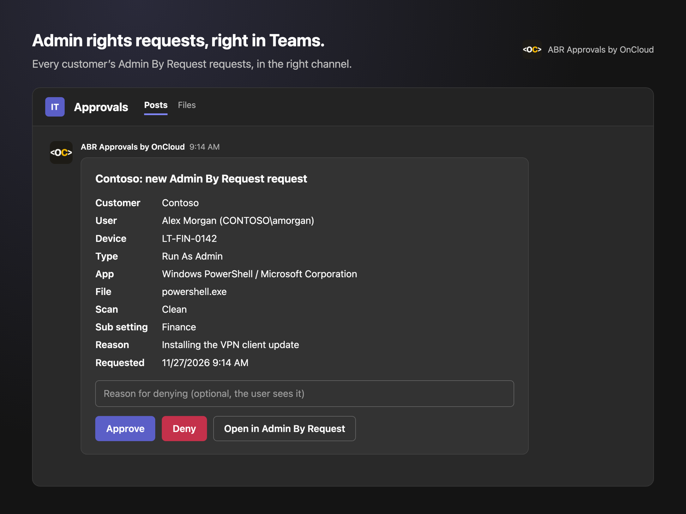
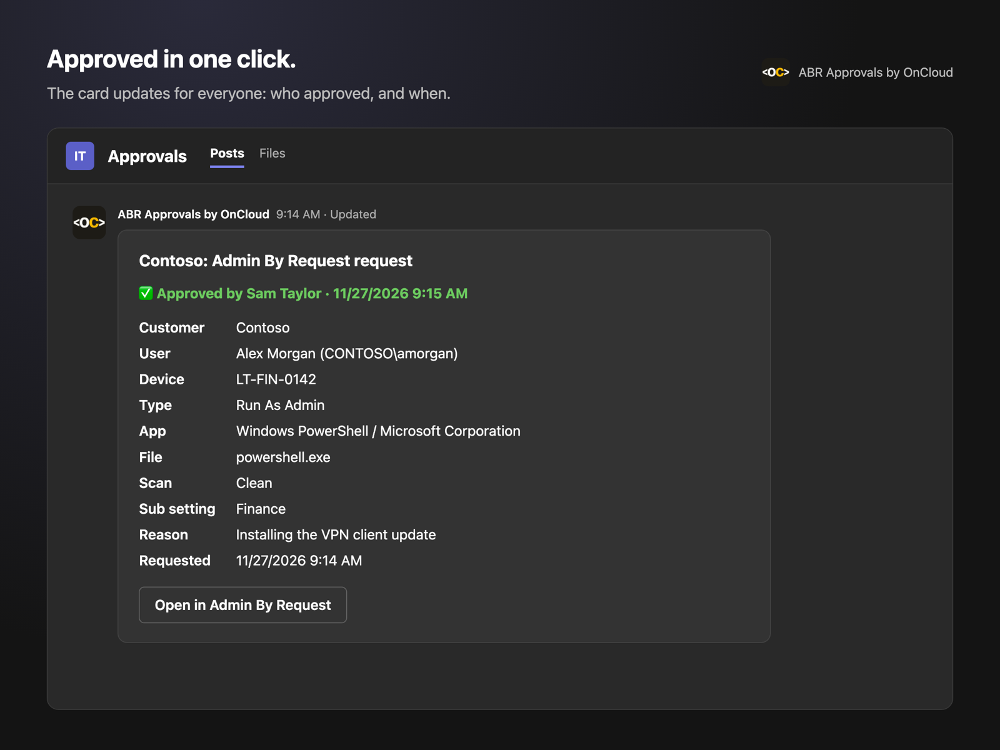
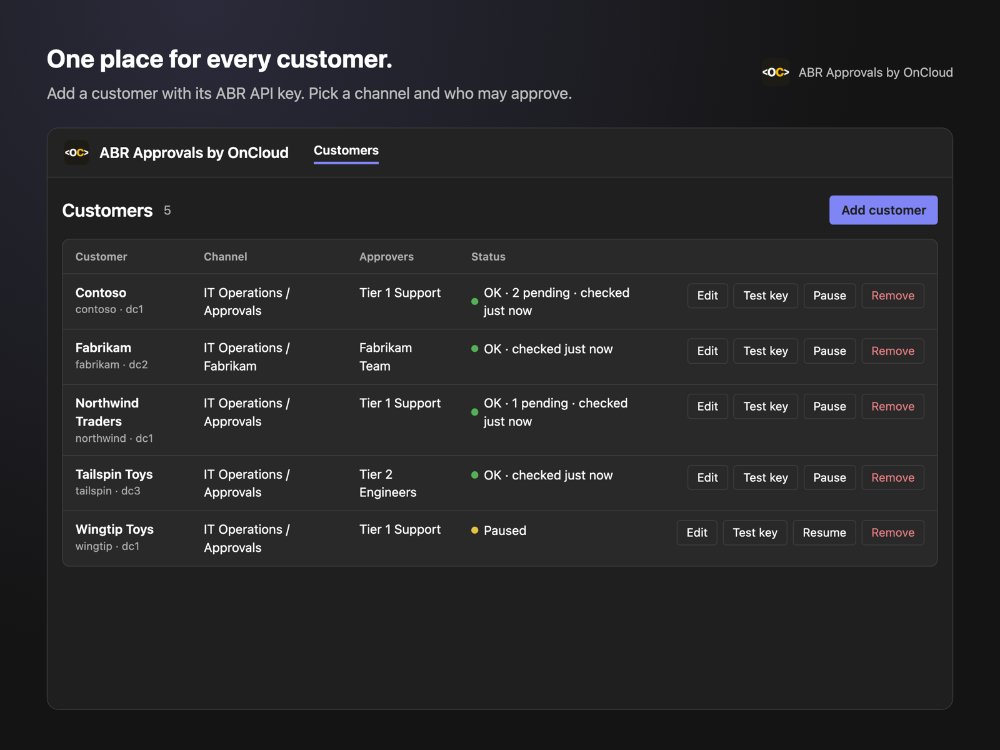

# ABR Approvals by OnCloud

Approve [Admin By Request](https://www.adminbyrequest.com) (ABR) requests in Microsoft Teams, for one ABR tenant
or for all of an MSP's customers. Requests show up as cards in the channel you pick per customer. Approvers
click **Approve** or **Deny** on the card, and the card updates for everyone with who decided and when.

> **Not an official Admin By Request product.** Built and maintained by OnCloud, an Admin By Request partner.
>
> **Preview (v0.1).** Tested with one ABR tenant, and multi-tenant tested by registering the same tenant twice.
> Feedback from MSPs running it with several customers is welcome. Report security issues privately: see [SECURITY.md](../SECURITY.md).

| A new request | After approval | Customers tab |
|---|---|---|
|  |  |  |

<sub>Sample data only.</sub>

## What you get

- **A card per request** in the customer's channel: user, device, app, file, scan result, sub setting, reason.
  Times show in each viewer's own time zone.
- **Approve / Deny on the card** (with an optional deny reason the user sees). Only members of the customer's
  approver group (an Entra security group) can decide. Everyone else gets a "not allowed" message, and the attempt is logged.
- **The card updates for everyone** with the decision. Requests handled in the ABR portal close their card automatically.
- **Customers tab** in Teams: add a customer with its ABR API key (the region is found automatically), pick a channel
  and an approver group, test the key, pause, remove.
- **Decision log** in Azure Table storage: who approved or denied what, for which customer, and refused attempts.

## Install (about 15 minutes)

You need: an Azure subscription (Owner or Contributor + User Access Administrator on a resource group),
a Global Administrator for step 2, and a Teams administrator for step 3.

**1. Deploy to Azure**

[](https://portal.azure.com/#create/Microsoft.Template/uri/https%3A%2F%2Fraw.githubusercontent.com%2Foncloud-public%2Fadminbyrequest-tools%2Fmain%2FABR-Teams-Approvals%2Finfra%2Fazuredeploy.json)

Pick a subscription, a new resource group and a region, then **Create**. It takes about 5 minutes.

**2. One command in Azure Cloud Shell** (Bash), as a Global Administrator. Copy it from the deployment's **Outputs** (`nextStep`), or:

```bash
curl -sL https://raw.githubusercontent.com/oncloud-public/adminbyrequest-tools/main/ABR-Teams-Approvals/infra/setup-entra.sh | bash -s -- <your resource group>
```

It grants the app two read-only Graph permissions (to check approver group membership), creates the app
registration for Teams sign-in (no secret), and creates the **ABR Approvals Admins** group with you in it.

**3. Teams**

1. Download the Teams app from `https://<your app>.azurewebsites.net/teams-app.zip` (the script prints the link).
2. Teams admin center > Teams apps > Manage apps > **Upload new app**.
3. Add the app to the team that gets the approval cards, and **@mention it once in each channel** you'll use
   (Teams only shows an app the channels it was added to).

**4. Add customers**

In Teams, open **Apps > ABR Approvals by OnCloud > Customers** and click **Add customer**. Create the API key in the
customer's ABR portal (Settings > Tenant Settings > API Keys).

## How it works

```
 Customer A ABR ─┐
 Customer B ABR ─┼─ every minute ─►  App Service (Node.js)  ──►  Azure Bot  ──►  Teams channels
 Customer C ABR ─┘  (each with its      │  bot, poller, Customers tab               cards with Approve / Deny
                     own API key)       ├── Key Vault: one ABR key per customer         │
                                        ├── Tables: customers, channels, cards, log     │
                                        └── Graph: is the clicker an approver? ◄────────┘
```

| Azure resource | Purpose |
|---|---|
| App Service (Linux, B1) | The bot, the poller and the Customers tab (Node.js) |
| Azure Bot (F0, free) | Connects the app to Teams |
| User-assigned managed identity | The app's only identity: no secrets anywhere |
| Key Vault (RBAC) | One ABR API key per customer, `abr-key-<customer>` |
| Storage tables | `botcustomers`, `botchannels`, `botposted`, `botdecisions` |

Cost: about $13/month for the App Service (B1), plus cents for Key Vault and storage.

### Things worth knowing about the ABR API

- **Request ids are reused.** When the same user asks for the same app again, ABR returns the same request id.
  The app identifies a request by id + request time, and an old card can never approve a newer request.
- `requestTime` is UTC without a zone (`2026-11-26T21:47:45`).
- API keys have no scopes: each key gives full API access to that ABR tenant. Keep them only in Key Vault.
- Denying is `DELETE /requests/{id}?reason=...` (works, not in the public docs).

## Security

- No secrets: the app uses a managed identity for Bot Service, Key Vault, storage and Graph. Teams sign-in to the tab uses SSO.
- ABR keys are written to Key Vault and never shown again or returned by the API.
- Only the customer's approver group can approve or deny. Only the admin group can manage customers.
- Recommended: Conditional Access (MFA, compliant device) for approvers and admins; Key Vault diagnostic logs; few Owners on the resource group.

## Update

Each version is a GitHub release with its own package (`teams-approvals-v<version>`). To update, set the app setting
`WEBSITE_RUN_FROM_PACKAGE` (portal > the App Service > Environment variables) to the new release's
`abr-approvals-bot.zip` URL and save: the app restarts on the new version. Customers, keys and history stay.

Re-deploy the template only when a release says so. A re-deploy resets the app settings, so run the Cloud Shell
command from step 2 again afterwards: it's safe to repeat and restores the Teams sign-in settings.

## Develop

`src/` is the app (Node.js), `public/` the Customers tab, `infra/` the template (`main.bicep`, compiled to
`azuredeploy.json` with `az bicep build`) and the Entra setup script. `tools/build-package.sh` builds the release zip
(code + production dependencies) that the template runs.

## License

[MIT](../LICENSE). The OnCloud name and logo are not covered by the license.
